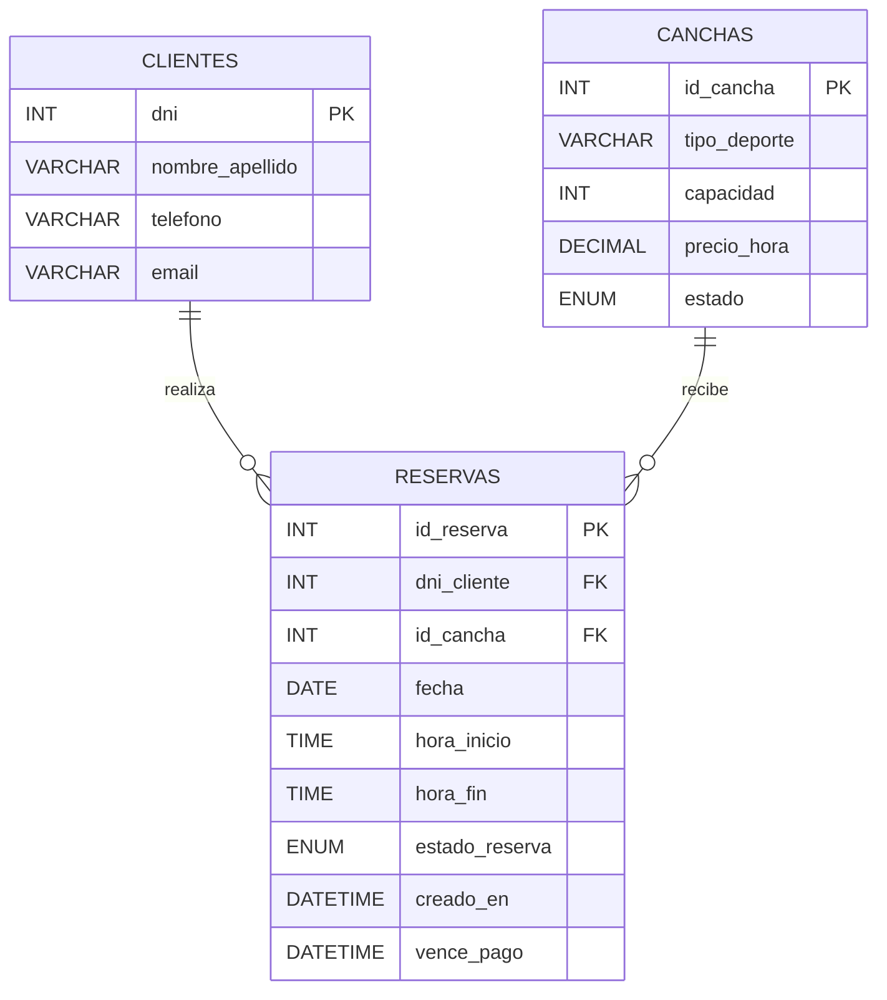

# Modelo de datos

## Propósito y estado

Este documento describe el modelo relacional MySQL de PadelBeche según el esquema
de `BASE_DE_DATOS/schema_mysql.sql` y las operaciones de acceso a datos de los
módulos `TKINTER/modelo_*.py`. La aplicación utiliza MySQL para guardar y
consultar clientes, canchas y reservas. La conexión se configura en
`BASE_DE_DATOS/database.py` mediante variables de entorno.

El modelo está formado por tres entidades: `clientes`, `canchas` y
`reservas`. Los roles de sesión se gestionan desde Python y no se guardan en
estas tablas.

## Diagrama relacional

## Entidades y atributos

### Clientes

Guarda los datos de contacto de las personas que realizan reservas. No existe
una columna `estado_cliente`; la operación disponible es la eliminación del
registro.

| Campo | Tipo | Restricciones y descripción |
|---|---|---|
| `dni` | `INT` | Clave primaria y obligatorio. Identifica de forma única al cliente. |
| `nombre_apellido` | `VARCHAR(100)` | Obligatorio. |
| `telefono` | `VARCHAR(20)` | Obligatorio. |
| `email` | `VARCHAR(100)` | Obligatorio. |

### Canchas

Guarda las características de las instalaciones deportivas.

| Campo | Tipo | Restricciones y descripción |
|---|---|---|
| `id_cancha` | `INT` | Clave primaria con `AUTO_INCREMENT`. |
| `tipo_deporte` | `VARCHAR(20)` | Obligatorio; por ejemplo, pádel o fútbol. |
| `capacidad` | `INT` | Obligatorio; debe ser mayor que cero. |
| `precio_hora` | `DECIMAL(10,2)` | Obligatorio; debe ser mayor que cero. |
| `estado` | `ENUM('Activa', 'Inactiva')` | Obligatorio; valor predeterminado `Activa`. |

### Reservas

Vincula a un cliente con una cancha para una fecha y franja horaria.

| Campo | Tipo | Restricciones y descripción |
|---|---|---|
| `id_reserva` | `INT` | Clave primaria con `AUTO_INCREMENT`. |
| `dni_cliente` | `INT` | Obligatorio; clave foránea a `clientes.dni`. |
| `id_cancha` | `INT` | Obligatorio; clave foránea a `canchas.id_cancha`. |
| `fecha` | `DATE` | Obligatorio; fecha del turno. |
| `hora_inicio` | `TIME` | Obligatorio; hora de comienzo. |
| `hora_fin` | `TIME` | Obligatorio; debe ser posterior a `hora_inicio`. |
| `estado_reserva` | `ENUM('Confirmada', 'Pendiente', 'Cancelada')` | Obligatorio. |
| `creado_en` | `DATETIME` | Obligatorio; valor predeterminado `CURRENT_TIMESTAMP`. |
| `vence_pago` | `DATETIME` | Puede ser `NULL`; una reserva pendiente debe informar el vencimiento. |

## Relaciones e integridad referencial

- Un cliente puede tener ninguna, una o muchas reservas; cada reserva pertenece
  a un único cliente.
- Una cancha puede tener ninguna, una o muchas reservas; cada reserva pertenece
  a una única cancha.
- `reservas.dni_cliente` referencia a `clientes.dni`.
- `reservas.id_cancha` referencia a `canchas.id_cancha`.
- Las claves foráneas requieren que existan el cliente y la cancha asociados a
  cada reserva. El esquema no define eliminación en cascada.

## Restricciones y validaciones

### Restricciones de MySQL

- `chk_canchas_capacidad`: `capacidad > 0`.
- `chk_canchas_precio`: `precio_hora > 0`.
- `chk_reservas_horario`: `hora_fin > hora_inicio`.
- `chk_reservas_vencimiento`: si `estado_reserva` es `Pendiente`,
  `vence_pago` no puede ser `NULL`.
- Las claves primarias impiden identificadores duplicados. Las claves foráneas
  protegen las relaciones entre reservas, clientes y canchas.

### Triggers del esquema

- `validar_cancha_activa`: antes de insertar una reserva, comprueba que la
  cancha esté `Activa`.
- `validar_horario_reserva`: antes de insertar una reserva, rechaza horarios
  superpuestos para la misma cancha y fecha si la reserva existente está
  `Confirmada` o `Pendiente`. Una reserva `Cancelada` no bloquea el horario.

### Validaciones de la aplicación

La interfaz valida los datos antes de guardarlos. Entre las reglas observadas
están el DNI numérico de 7 u 8 dígitos, el nombre, el teléfono y el correo
electrónico. Para reservas, la aplicación calcula el vencimiento de las
pendientes y revisa los vencimientos periódicamente.

## Roles

El rol actual se mantiene en `sesion.py` durante el uso de la aplicación, no en
las tablas del modelo. La interfaz usa ese rol para mostrar o permitir
acciones. En clientes, el empleado puede dar de alta; el Supervisor puede
modificar y eliminar.

## Eliminación de clientes: comportamiento actual

El módulo `TKINTER/modelo_clientes.py` elimina primero las reservas asociadas a
un cliente y después elimina al cliente, dentro de una transacción. Por eso, al
eliminar desde esa función también se borra el historial de reservas del
cliente. 

## Vencimiento de reservas pendientes

La tabla guarda la fecha límite en `vence_pago`. La aplicación establece una
tolerancia de 15 minutos y comprueba periódicamente las reservas pendientes
vencidas para actualizar su estado. La restricción `CHECK` solo exige que el
vencimiento esté informado; no mide el tiempo ni cambia el estado por sí sola.

## Datos de ejemplo

El esquema incluye datos de prueba para clientes, canchas y reservas. Las
reservas `Pendiente` de la carga inicial incluyen `vence_pago` para cumplir la
restricción correspondiente.

## Normalización

Los datos se separan según su entidad: los datos personales se guardan una sola
vez en `clientes`, las características de las instalaciones en `canchas` y
los datos de cada turno en `reservas`. Las claves primarias identifican cada
registro y las claves foráneas expresan las relaciones. Esta organización
reduce la duplicación y sigue el objetivo de la tercera forma normal (3FN).
